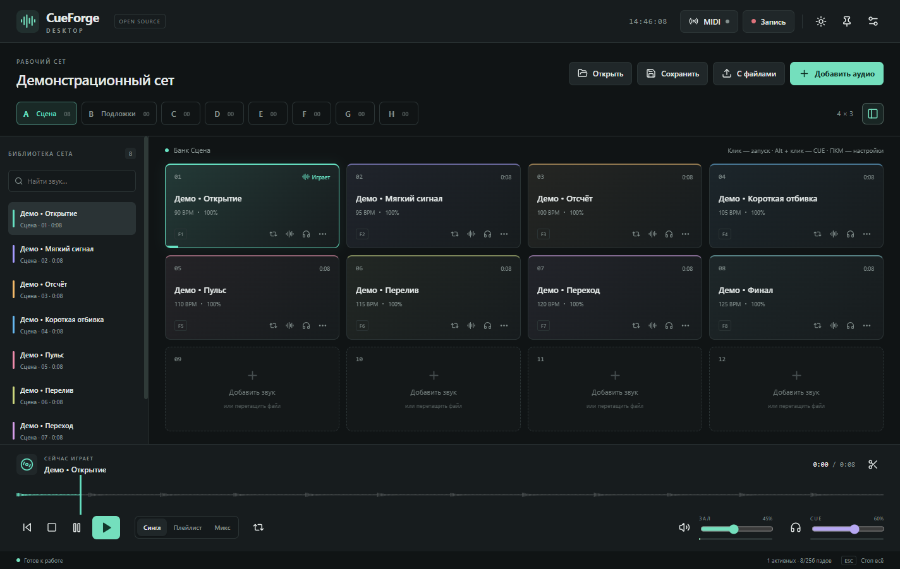

# CueForge Desktop

Открытый триггер-плеер для Windows: подготовьте звуки в пэдах и запускайте их во время мероприятия мышью, клавиатурой или MIDI-контроллером.

**Статус: ранняя версия 0.2.0.** Реализован набор функций по публичным материалам HypeCue Pro и исследованию бесплатной 0.5.8. Полное совпадение поведения с Pro не подтверждено: активированной Pro и аппаратных MIDI-контроллеров в тестовой среде нет. Это самостоятельный проект, не связанный с HypeCue.

## Возможности



- 8 банков по 144 ячейки. Задайте от 1 до 12 столбцов и строк или выберите готовую сетку.
- Пэды с именем, цветом, громкостью, повтором, обрезкой и индивидуальными фейдами.
- Режимы «Сингл», «Плейлист» и «Микс», пауза, продолжение, перемотка, аварийная остановка.
- Раздельные выходы зала и CUE, регуляторы громкости и индикаторы уровня.
- Запись live-микса в WAV PCM16 stereo, напрямую на диск; CUE в запись не попадает.
- BPM-анализ и форма волны; отдельный процесс для длинных файлов, ограниченный аудиокэш.
- «Начало отсюда» запоминает текущую позицию для следующего запуска пэда.
- Редактор фрагментов с точным временем и экспортом WAV через FFmpeg.
- Локальные и глобальные горячие клавиши для ячеек, банков и транспорта.
- MIDI Note/CC, обучение, два режима привязки, журнал сообщений, базовые LED-профили.
- Поиск по всем банкам, перенос и перестановка пэдов, восстановление потерянных файлов.
- Сеты `.cueforge`, импорт/экспорт `.hcpl` v1/v2, перенос вместе с аудиофайлами.
- Библиотека аудио, автоматическое сохранение с резервной копией, один экземпляр приложения.
- Тёмная и светлая темы, окно поверх остальных, безопасный графический режим.

## Запуск в Windows

Скачайте `CueForge-0.2.0-Windows-x64.exe` из [Releases](https://github.com/miramour/cueforge-desktop/releases/tag/v0.2.0) и запустите. Установка Node.js для готового приложения не нужна. Portable-версия распаковывает приложение во временную папку; настройки сохраняются в `%APPDATA%/cueforge-desktop`.

Для знакомства распакуйте `CueForge-demo.zip` из того же релиза и откройте находящийся внутри файл `.cueforge`. Восемь коротких звуков созданы программно и свободно распространяются вместе с проектом.

Требования: Windows 10/11 x64, аудиоустройство с рабочим драйвером. Для отдельного CUE нужен второй физический аудиовыход. Выпуск не подписан коммерческим сертификатом.

1. Нажмите **Добавить аудио** или перетащите файлы на пэды.
2. Щёлкните по пэду для запуска. ПКМ открывает настройки; Alt + клик запускает CUE.
3. В **Настройки → Аудио** выберите выходы и поведение повторного нажатия.
4. В **Управление** назначьте клавиши. Область «Всегда» действует и вне окна приложения.
5. Нажмите **Запись**, выберите WAV-файл, запустите звуки и снова нажмите запись для завершения.
6. **С файлами** сохраняет переносимый набор. Переносите файл сета и соседнюю папку аудио вместе.

Esc плавно останавливает звук; повторное нажатие во время затухания глушит сразу. В открытом диалоге Esc закрывает диалог. Изменения фейда/обрезки пэда применяются при следующем запуске.

## Разработка

Нужны Windows x64, Git и Node.js 24 LTS. Все команды выполняются из папки репозитория:

```powershell
npm ci
npm run setup:audio
npm run dev
```

Подготовка аудио загружает фиксированную версию FFmpeg 9.0.1 из релиза Gyan на GitHub и сверяет SHA-256. FFmpeg и его лицензия размещаются в `vendor/ffmpeg`, двоичные файлы не коммитятся. Интернет нужен для подготовки среды; воспроизведение работает офлайн.

```powershell
npm test
npm run build
npm run test:e2e
npm run package
```

Результат сборки: `release/CueForge-0.2.0-Windows-x64.exe`. Для запуска без GPU используйте `CueForge.exe --safe-mode` из распакованной сборки либо выключите аппаратное ускорение в настройках.

## Документация

- [Инструкция](docs/USER_GUIDE.md)
- [Исследование функций и границы совместимости](docs/FEATURES.md)
- [Архитектура](docs/ARCHITECTURE.md)
- [Проверки](docs/TESTING.md)
- [Сторонние компоненты и лицензии](THIRD_PARTY_NOTICES.md)

## Лицензия

Собственный код CueForge: [MIT](LICENSE). Поставляемый отдельным процессом FFmpeg: GPLv3; его лицензия и сведения об исходниках входят в дистрибутив. Аудиофайлы пользователя в репозиторий не включаются.
