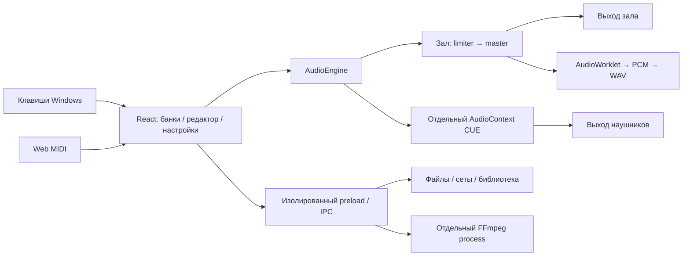

# Архитектура

Electron 44, TypeScript, React 19, Vite. Приложение загружает собственный локальный интерфейс. Внешние страницы не открываются в привилегированном окне.

## Границы процессов

- `src/model.ts`: валидация схемы, значения по умолчанию, восемь банков; `hcpl.ts`: адаптер формата.
- `src/audio.ts`: независимые аудиоконтексты, кэш до 256 МиБ, голоса, фейды, запись.
- `src/analysis.worker.ts`: анализ импульсов BPM вне UI-потока.
- `src/midi.ts`: парсинг MIDI, обучение, дедупликация, LED-команды.
- `electron/main.ts`: только перечисленные IPC-операции, нативные диалоги, глобальные клавиши, single-instance lock.
- `electron/files.ts`: атомарная запись JSON, резервная копия, PCM/WAV, потоковое чтение диапазонов.
- `electron/media.ts`: очередь потокового анализа и экспорт через FFmpeg. Не использует shell для запуска команды, передаёт аргументы массивом; сетевые протоколы декодера выключены.

## Хранение

`%APPDATA%/cueforge-desktop/session.json` содержит рабочий сет; `.bak` — предыдущую версию. Тесты используют отдельные профили через `CUEFORGE_DATA`. Аудио остаётся по исходному пути либо копируется в выбранную библиотеку. При экспорте пути относительны расположению сета.

## Изоляция

`contextIsolation: true`, `nodeIntegration: false`, `sandbox: true`; CSP ограничивает скрипты собственными файлами. Аудио доступно только через случайный идентификатор протокола `cue-audio` после регистрации аудиопути. JSON не исполняется; число банков, ячеек и размер метаданных ограничены. IPC проверяет основное окно-отправитель. Доступ к микрофону и камере не требуется.

Главный процесс выполняет файловые операции с правами пользователя. Импортированный сет может ссылаться на локальный аудиофайл; это намеренная возможность. Поэтому не открывайте непроверенные медиа без обычной осторожности. Источники не передаются внешним сервисам. Единственный сетевой запрос после установки — ручная проверка релиза GitHub.
